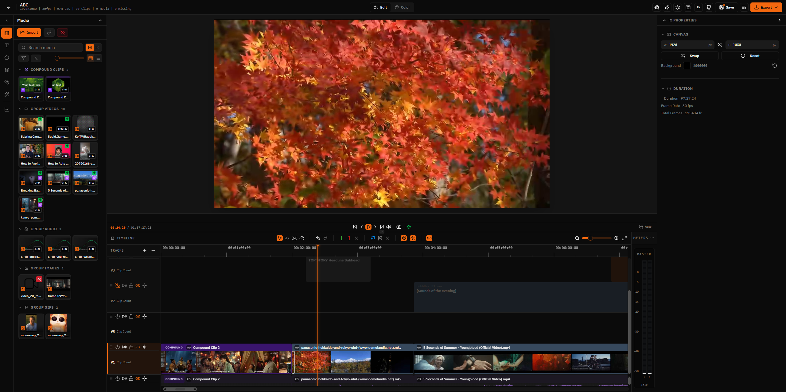

# EmbeddableCut

_A real video editor, in any app_ 🎬✂️

EmbeddableCut is an embeddable video editing SDK built from [FreeCut](https://github.com/walterlow/freecut), a browser-based multi-track editor. It keeps FreeCut's editor whole and makes it something you can build on: a framework-independent engine for editing, playback and rendering, the full editor to mount in your own app, and a headless Chrome renderer for your servers.

> **Status: pre-alpha.** The monorepo and the engine split are in place; the SDK, the Svelte 5 editor and URL-based media are being built. FreeCut's editor works exactly as it does upstream.



## Features

Everything FreeCut's editor does, the SDK keeps. Projects and media stay local: editing, preview, analysis, transcription, AI generation and export all run in the browser through WebGPU, WebCodecs, Web Workers, OPFS and the File System Access API.

### Timeline and editing

- **Multi-track timeline** with video, audio, text, image, shape, mask, Lottie and compound clip items, and several timelines per project as sequences.
- **Every pro edit:** linked audio and video, split, join, ripple, rolling, slip, slide and rate stretch, with a source monitor for insert and overwrite edits.
- **Cut-centered transitions** with live resize, alignment and source anchoring; fade, wipe, slide, flip, clock wipe, iris, dissolve, glitch, light leak and more.
- **Keyframes:** a bezier graph editor, dopesheet, easing presets, procedural motion (drift, sway, breath, spin, shake), and per-character text animation.

### Preview, effects and audio

- **Frame-accurate playback** through FreeCut's own clock, with fast scrub overlays, decoder prewarming and adaptive preview quality.
- **WebGPU effects:** blurs, color grading with curves, wheels and `.cube` LUTs, distortions, stylize effects, chroma key, 25 blend modes, masks and pen paths.
- **GPU scopes:** waveform, vectorscope and histogram.
- **Audio:** clip and track EQ, pitch shift, fades, faders, a master bus and LED meters, preserved through export.

### Media, AI and export

- **Import without copying:** video, audio, images, GIFs, SVG and Lottie, with Apple ProRes decode, proxies, filmstrips and waveforms.
- **Media at URLs, read in place:** streamed with range requests and a shared block cache instead of downloaded, with signed-URL renewal and host-supplied authentication.
- **On-device AI:** transcription and captions, scene detection and search, text-to-speech and music generation. Nothing is uploaded.
- **Export in the browser:** MP4, WebM, MOV and MKV in H.264, H.265, VP8, VP9 or AV1; MP3, AAC and WAV audio; burned-in, sidecar or embedded subtitles.

### Rendering on servers

- **The editor's own engine, headless.** The render service drives the same engine in Google Chrome, so a server render matches the editor's export.
- **A CLI, an HTTP API and a container:** render, grab frames, measure layouts and apply edit operations from a script or a service, with revisions, idempotent writes and crash-safe operations.

## Layout & Tech Stack

**⚙️ Engine: TypeScript, no UI framework.** `engine/` holds FreeCut's state, editing actions, media handling, persistence, effects, transitions, renderer and clock. Hosts bundle it as source.

**🖥️ Editor: React, moving to Svelte 5.** `web/` is FreeCut's editor, unchanged in behavior and look, built with Vite+ into a static PWA.

**🎥 Render: headless Chrome.** `render/` drives the engine through Playwright for CLIs and an HTTP service, with a container image for clusters.

**🎨 Rendering stack.** WebGPU for effects, compositing, transitions, masks and scopes; WebCodecs and [Mediabunny](https://mediabunny.dev/) for decode and export; [Transformers.js](https://huggingface.co/docs/transformers.js) and Kokoro for local AI.

**❄️ Nix.** One flake provides the dev shell, the packages and CI's checks.

## Philosophy

- **FreeCut stays whole.** Nothing in its editor is removed or simplified to make it embeddable. By default EmbeddableCut is FreeCut: the same features, look, editing behavior and render fidelity.
- **The engine owns the work.** Editing, playback and rendering live below any UI framework, so a host can drive them with or without the editor on screen.
- **One engine everywhere.** Preview, browser export and server rendering run the same code, so what an editor sees is what a server renders.
- **Stay close to upstream.** Every file keeps its path from FreeCut's tree, so FreeCut's fixes and features keep flowing in.

## Getting Started

Read [`docs/GETTING_STARTED.md`](docs/GETTING_STARTED.md). The short version:

```bash
nix develop
just web install
just web dev    # the editor at http://localhost:5173, in Chrome, Edge, Brave or Arc
just            # every other command
```

## Documentation

- [`docs/GETTING_STARTED.md`](docs/GETTING_STARTED.md): build, run, and test from source.
- [`docs/UPSTREAM.md`](docs/UPSTREAM.md): how FreeCut's changes are merged in.
- [`docs/SCHEMAS.md`](docs/SCHEMAS.md): the versioned formats and their migration policy.
- [`docs/MEDIA.md`](docs/MEDIA.md): local files and URL media, authentication, caching.
- [`sdk/README.md`](sdk/README.md): driving the editor from your own app.
- [`docs/DESIGN.md`](docs/DESIGN.md) and [`docs/PRODUCT.md`](docs/PRODUCT.md): FreeCut's design system and who it's for.
- [`render/AGENTS.md`](render/AGENTS.md): the render CLIs, HTTP service and container.
- [`CONTRIBUTING.md`](CONTRIBUTING.md): how changes land.
- [FreeCut's user guide](https://freecut.net/docs) covers the editor itself.

## License

[MIT](LICENSE), as FreeCut is. EmbeddableCut is a fork of [FreeCut](https://github.com/walterlow/freecut) and keeps its copyright notice.
